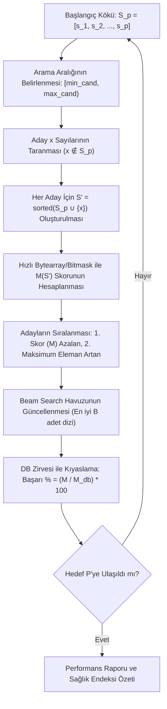

# PSPP Sağlıklı Kök Tabanlı İnkremental Büyütme Motoru (Root Grower)
## Çalışma Prensibi, Aday Arama Aralıkları ve Matematiksel Mantığı

---

### 1. Genel Felsefe: Kombinatoryel Aramadan Lineer Aramaya

Geleneksel PSPP çözücülerinde $P$ elemanlı bir küme aranırken $O(\binom{N}{P})$ boyutunda devasa bir kombinatoryel uzay taranır. Bu durum $P \ge 8$ sonrasında kaba kuvvet aramayı imkansız hale getirir.

**Kök Büyütme (Root Growth) Yaklaşımı:**
Her adımda sıfırdan yeni bir küme aramak yerine, daha önce kendini kanıtlamış bir **başlangıç kök kümesi ($S_{p_0}$)** sabit tutulur. $P \to P+1$ geçişinde kümeye sadece **tek bir yeni tam sayı ($x$)** eklenir:

$$S_{p+1} = S_p \cup \{x\}$$

Bu sayede arama uzayı her $P$ geçişi için **tek boyutlu lineer bir aralığa $O(K)$** indirgenir.

---

### 2. Algoritmanın Adım Adım İşleyişi



---

### 3. Aday Sayılar Hangi Aralıktan Çekilir? (`min_cand` ve `max_cand`)

Bir $S_p$ kümesine eklenecek $x$ tam sayısı rastgele aranmaz. Matematiksel sınırlar çerçevesinde tanımlı bir aralıkta taranır:

#### A. Alt Sınır (`min_cand`)
* **Serbest Mod (Varsayılan):** `min_cand = 1`
  * Sayı kümenin en başına, arasına veya sonuna yerleşebilir ($x \notin S_p$).
  * Bu mod, küçük sayı eksikliklerini veya kritik iç fark boşluklarını kapatmak için gereklidir.
* **Sadece Sona Ekleme (Monoton Mod):** `min_cand = max(S_p) + 1`
  * Yalnızca mevcut elemanlardan daha büyük sayılar denenir (delta dizisine yeni bir terim eklemeye eşdeğerdir).

#### B. Üst Sınır (`max_cand`)
Yeni eklenecek sayının gereksiz yere sonsuza kadar aranmasını önlemek için dinamik bir üst sınır formülü kullanılır:

$$\text{max\_cand} = \max\Big(\lfloor \max(S_p) \times 2.2 \rfloor, \; \lfloor M(S_p) \times 2.0 \rfloor\Big) + 30$$

> **Neden bu üst sınır?**
> PSPP tanımında üretilen sayılar $a_i$, $a_i + a_j$ ve $|a_i - a_j|$ biçimindedir.
> Eğer $x$ sayısı mevcut $M(S_p)$ skorunun iki katından çok daha büyük seçilirse (örneğin $5 \cdot M$), bu sayının $S_p$ elemanlarıyla oluşturacağı farklar da ($x - s_i$) $M$'den çok daha büyük olacaktır. Dolayısıyla $1, 2, \dots, M$ arasındaki boşlukları kapatmaya hiçbir katkı sağlayamaz. Bu nedenle $2 \cdot M$ ve $2.2 \cdot \max(S_p)$ tavanı tüm potansiyel köprüleri kapsayan güvenli ve dar bir aralıktır.

#### C. Küme İçi Filtreleme
$x$ sayısı `range(min_cand, max_cand)` içinde taranırken:
* Eğer $x \in S_p$ ise test edilmeden doğrudan atlanır (`continue`). Kümeye yalnızca yeni bir eleman eklenebilir.

---

### 4. Adaylar Hangi Sırayla ve Hangi Kriterlere Göre Seçilir?

1. **Arama Sırası:**
   Adaylar $x = min\_cand$ değerinden başlayarak $max\_cand - 1$'e kadar küçükten büyüğe sırayla taranır.

2. **Skorlama (Fast Bytearray Evaluation):**
   Her $x$ için $S' = \text{sorted}(S_p \cup \{x\})$ kümesi oluşturulur. Donanımsal bellek taraması (`bytearray.find(0, 1)`) kullanılarak $1$'den başlayan ilk eksik sayı ($M$) mikrosaniye mertebesinde (yaklaşık $1.3 \ \mu\text{s}$) tespit edilir.

3. **Sıralama ve Karar Öncelikleri (Tie-Breaking Kuralı):**
   Taranan yüzlerce aday içerisinden seçim yapılırken iki kademeli bir sıralama anahtarı uygulanır:

   $$\text{Sıralama Anahtarı} = \Big(M(S'), \; -\max(S')\Big) \quad \text{[Azalan Sıralama]}$$

   * **1. Öncelik (Skor Maksimizasyonu):** En yüksek ardışık $M$ skorunu veren aday daima en öne geçer.
   * **2. Öncelik (Kompaktlık / Yoğunluk):** Eğer birden fazla aday tam olarak aynı $M$ skorunu veriyorsa (örneğin hem $x=18$ hem $x=24$ aynı skoru veriyorsa), kümenin en büyük elemanı ($\max(S')$) **daha küçük olan** aday tercih edilir.
     * Bu sayede dizi gereksiz yere şişmez; elemanlar birbirine yakın ve yoğun kalarak ileriki boyutlar için daha doğurgan bir zemin hazırlar.

4. **Beam Search Mekanizması ($B$ Genişliği):**
   * **Saf Açgözlü ($B=1$):** Sadece en yüksek puanlı 1 adayı seçer.
   * **Beam Search ($B=10-15$, Varsayılan):** Her adımda en yüksek skora sahip ilk $B$ adayı hafızasında tutar. Böylece o anki adımda eşit veya 1 puan geride olan ama bir sonraki adımda büyük bir patlama yapacak potansiyel dallar elenmez.

---

### 5. Yüzdelik Başarı Oranı (% Verimlilik) ve Sağlık Endeksi

Her $P$ adımında bulunan skor, `pspp_database.json` içindeki tescilli optimumla kıyaslanır:

$$\text{Başarı Oranı } (\eta) = \frac{M_{\text{kök}}(P)}{M_{\text{db}}(P)} \times 100$$

Bir kökün ne kadar "sağlıklı" olduğunu ölçmek için ise tüm genişleme yolu boyunca koruduğu ortalama verimlilik hesaplanır:

$$\text{Sağlık Endeksi } (H) = \frac{1}{P_{\text{hedef}} - P_{\text{başlangıç}} + 1} \sum_{P=P_{\text{başlangıç}}}^{P_{\text{hedef}}} \frac{M_{\text{kök}}(P)}{M_{\text{db}}(P)} \times 100$$

---

### 6. Kritik Ayrım: Saf Greedy vs. Beam Search (Sayılar Neden Değişti?)

Kök büyütme çalıştırıldığında iki farklı büyüme davranışı gözlemlenir:

#### A. Saf Açgözlü Mod (Pure Greedy, `beam_width = 1`): Kesin ve Değişmez Soy Ağacı
Bu modda her adımda sadece o anki en yüksek skoru veren **tek bir sayı** kümeye eklenir. Önceki adımlarda eklenen hiçbir sayı asla değişmez:

| P | Skor (M) | Eklenen | Delta Dizisi (Farklar) | Kümülatif Normal Dizi |
| :---: | :---: | :---: | :--- | :--- |
| **3** | 8 | - | `[2, 1, 2]` | `[2, 3, 5]` |
| **4** | 12 | **+6** | `[2, 1, 2, 1]` | `[2, 3, 5, 6]` |
| **5** | 14 | **+7** | `[2, 1, 2, 1, 1]` | `[2, 3, 5, 6, 7]` |
| **6** | 17 | **+10** | `[2, 1, 2, 1, 1, 3]` | `[2, 3, 5, 6, 7, 10]` |
| **7** | 23 | **+16** | `[2, 1, 2, 1, 1, 3, 6]` | `[2, 3, 5, 6, 7, 10, 16]` |
| **8** | 29 | **+22** | `[2, 1, 2, 1, 1, 3, 6, 6]` | `[2, 3, 5, 6, 7, 10, 16, 22]` |
| **9** | 35 | **+28** | `[2, 1, 2, 1, 1, 3, 6, 6, 6]` | `[2, 3, 5, 6, 7, 10, 16, 22, 28]` |
| **10** | 41 | **+34** | `[2, 1, 2, 1, 1, 3, 6, 6, 6, 6]` | `[2, 3, 5, 6, 7, 10, 16, 22, 28, 34]` |

* **Sonuç:** $P=4$'te eklenen `6` sayısı tüm yolculuk boyunca yerinde kalmıştır. Delta dizisi son terimlerde periyodik olarak `+6` eklenen bir aritmetik diziye oturmuş ve $P=10$'da $M=41$'e ulaşmıştır.

---

#### B. Beam Search Modu (`beam_width = 10`): Çoklu Dal ve Soy Liderliği Değişimi
Beam Search tek bir adaya mahkum kalmamak için her adımda en iyi $B$ adet farklı dalı canlı tutar:
* $P=4$'te **A Dalı** (`[2, 3, 5, 6]`, $M=12$) anlık olarak birinci sıradadır. Ancak **B Dalı** (`[1, 2, 3, 5]`, $M=11$) ve **C Dalı** (`[2, 3, 5, 14]`, $M=11$) da hafızada tutulur.
* $P=5$'te A Dalı sadece $M=14$'e çıkabilirken, C Dalı $+18$ alarak $M=21$'e fırlar ve jenerasyonun lideri olur!
* $P=6$'da ise B Dalı (`[1, 2, 3, 5]`) arka arkaya $+14$ ve $+23$ alarak $M=26$ ile mutlak liderliği ele geçirir!

Jenerasyon liderlerinin tablosu:

| P | Skor (M) | Eklenen | Delta Dizisi (Farklar) | Kümülatif Normal Dizi | Açıklama |
| :---: | :---: | :---: | :--- | :--- | :--- |
| **3** | 8 | - | `[2, 1, 2]` | `[2, 3, 5]` | Başlangıç Kökü |
| **4** | 12 | +6 | `[2, 1, 2, 1]` | `[2, 3, 5, 6]` | O anki A Dalı Lider |
| **5** | 21 | +18 | `[2, 1, 2, 9, 4]` | `[2, 3, 5, 14, 18]` | C Dalı Liderliği Devraldı |
| **6** | 26 | +23 | `[1, 1, 1, 2, 9, 9]` | `[1, 2, 3, 5, 14, 23]` | **B Dalı Liderliği Aldı (Şampiyon)** |
| **7** | 35 | +32 | `[1, 1, 1, 2, 9, 9, 9]` | `[1, 2, 3, 5, 14, 23, 32]` | B Dalı Soyundan $+9$ Delta |
| **8** | 44 | +41 | `[1, 1, 1, 2, 9, 9, 9, 9]` | `[1, 2, 3, 5, 14, 23, 32, 41]` | B Dalı Soyundan $+9$ Delta |
| **9** | 53 | +50 | `[1, 1, 1, 2, 9, 9, 9, 9, 9]` | `[1, 2, 3, 5, 14, 23, 32, 41, 50]` | B Dalı Soyundan $+9$ Delta |
| **10** | 62 | +59 | `[1, 1, 1, 2, 9, 9, 9, 9, 9, 9]` | `[1, 2, 3, 5, 14, 23, 32, 41, 50, 59]` | B Dalı Soyundan $+9$ Delta |

> **Neden Delta Gösterimi Şarttır?**
> Kümülatif dizide sayılar `[1, 2, 3, 5, 14, 23, 32, 41, 50, 59]` şeklinde büyüdüğü için matematiksel simetriyi görmek zordur.
> Ancak **Delta (Farklar)** dizisine bakıldığında:
> `[1, 1, 1, 2, 9, 9, 9, 9, 9, 9]`
> Sistemin $P=6$'dan itibaren gövdeye **tam bir adet `9` farkı** ekleyerek kusursuz bir modüler periyoda oturduğu apaçık görülür!

---

### 7. Nihai Şampiyonun Saf Soy Ağacı (Backtracked Lineage)

$P=10$'da $M=62$ skoruna ulaşan şampiyon bireyin geriye doğru kendi soy ağacı çıkarıldığında:
* $P=3$: `[2, 3, 5]` $\to$ Delta: `[2, 1, 2]`
* $P=4$: `[1, 2, 3, 5]` $\to$ Delta: `[1, 1, 1, 2]` (Kümeye 1 eklendi)
* $P=5$: `[1, 2, 3, 5, 14]` $\to$ Delta: `[1, 1, 1, 2, 9]` (Kümeye 14 eklendi, delta +9)
* $P=6$: `[1, 2, 3, 5, 14, 23]` $\to$ Delta: `[1, 1, 1, 2, 9, 9]` (Kümeye 23 eklendi, delta +9)
* $P=7$: `[1, 2, 3, 5, 14, 23, 32]` $\to$ Delta: `[1, 1, 1, 2, 9, 9, 9]` (Kümeye 32 eklendi, delta +9)
* $P=8$: `[1, 2, 3, 5, 14, 23, 32, 41]` $\to$ Delta: `[1, 1, 1, 2, 9, 9, 9, 9]` (Kümeye 41 eklendi, delta +9)

Görüldüğü üzere, şampiyonun kendi soyunda **asla hiçbir sayı değişmemiş**, sadece her adımda tam $+9$ fark oluşturan tek bir sayı eklenerek büyümüştür!

---

### 8. İlgili Komutlar ve Kullanım

* **Tek bir kökü büyütmek ve başarı yüzdelerini izlemek:**
  ```powershell
  python scripts/root_grower.py --seed 2,3,5 --target-p 20 --beam 10
  ```

* **Potansiyel kökler arasında sağlık taraması yapmak:**
  ```powershell
  python scripts/root_grower.py --scan-roots --p-root 3 --target-p 12
  ```

* **Tüm köklerin karşılaştırma matrisini görmek:**
  ```powershell
  python scripts/benchmark_roots.py
  ```

* **Yeni bir rekor veya alternatif bulunduğunda veritabanına otomatik kaydetmek:**
  ```powershell
  python scripts/root_grower.py --seed 4,6,7,9 --target-p 30 --beam 15 --submit
  ```
