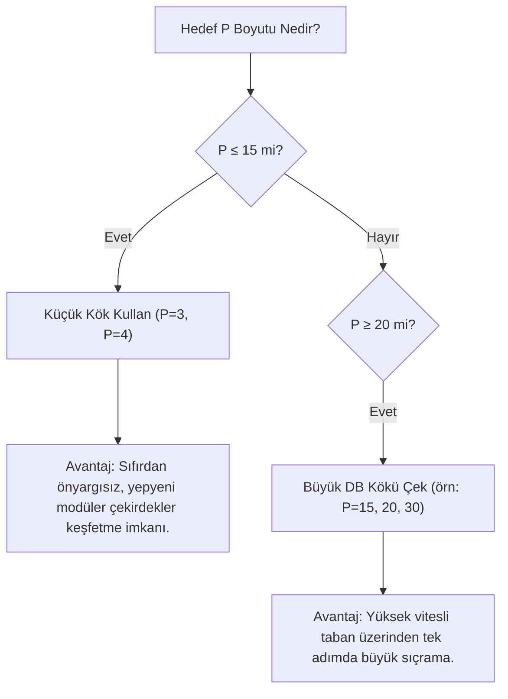

# PSPP Kök Boyutu ve Matematiksel Vites Stratejisi
## Küçük Kökler ($P=3, 4$) vs. Büyük DB Kökleri ($P \ge 15$) Analizi

---

### 1. Temel Soru: Kökler Her Zaman Küçük mü Olmalıdır?

> **Soru:** Kökler (seed) her zaman $P=3$ veya $P=4$ gibi küçük sayılar mı olmalıdır? Büyük $P$ değerlerini ararken veritabanından hazır optimum çekmek veya büyük köklerle başlamak karlı olur mu? Yoksa küçük kökle başlamak her zaman daha mı iyidir?

**Cevap:** **Kesinlikle hayır, kökler küçük olmak zorunda değildir!** Hatta $P \ge 20$ seviyesindeki büyük hedefleri ararken veritabanından hazır büyük bir kök çekmek **çok daha karlı, hızlı ve verimlidir.**

---

### 2. Matematiksel "Vites" Prensibi ($dM/dP$ Eğim Analizi)

PSPP dizilerinde her eklenen elemanın skora katkısı, kökün kendi içinde barındırdığı **modüler kapsama genişliğine (kalan çeşitliliğine)** bağlıdır:

* **Küçük Kökler ($P=3, 4$ — 1. Vites):**
  * Örneğin $P=3$ kökü olan `[2, 3, 5]`, kendi içinde en fazla **modulo 9** artıklarını (1'den 8'e kadar) üretebilir.
  * Bu kök periyodik büyüme fazına oturduğunda her yeni adımda gövdeye $+9$ eklenir. Yani adım başına skor artışı en fazla:
    $$\frac{\Delta M}{\Delta P} \approx +8.5 \sim +9.0 \quad \text{M / adım}$$
  * $P=10$ seviyesinde bu artış harika bir verimlilik (%82) sağlarken, $P=35$'e geldiğimizde veritabanındaki optimum eğim $+35$'tir! Her adımda $+9$ alan bir dizi, her adımda $+35$ isteyen bir zirveye asla yetişemez.

* **Büyük DB Kökleri ($P=15, 20, 30$ — Yüksek Vites):**
  * Veritabanında $P=15$ veya $P=20$ için bulunan çözümler, binlerce saatlik optimizasyonla bulunmuş çok daha geniş modüler tabanlara (modulo 18, 20, 22) sahiptir.
  * Bu kökler yüksek vitesli motorlar gibidir. Onlara tek bir sayı eklediğinizde skoru $+9$ değil, **tek adımda $+16$ ila $+22$ arası devasa sıçramalarla** büyütürler!

---

### 3. Canlı Deney Sonuçları: Hedef $P=35$
*(Tarihi Deney Notu: Deneyin yapıldığı tarihte $P=35$ DB zirvesi $M=647$ ve $P=30$ zirvesi $M=504$ idi. Güncel veritabanında Kuyruk-Yoğun model ile $P=30 \implies \mathbf{M=510}$ ve $P=35 \implies \mathbf{M=682}$ olarak güncellenmiştir; ancak kök büyütme vites dinamikleri aynı matematiksel prensiple geçerliliğini korumaktadır).*

Aynı $P=35$ hedefine farklı boyutlardaki başlangıç kökleriyle tırmanıldığında elde edilen net veriler:

| Başlangıç Kökü | Başlangıç Durumu | Ulaşılan Sonuç ($P=35$) | DB Başarı Oranı % | Adım Başına Skor Kazancı | Performans Değerlendirmesi |
| :--- | :---: | :---: | :---: | :---: | :--- |
| **Küçük Seed $P=3$** `[2, 3, 5]` | $P=3 \ (M=8)$ | **$M = 287$** | % 44.4 📉 | **$+8.72$ M / adım** | Düşük vites; büyük $P$'de geride kaldı. |
| **DB Seed $P=15$** | $P=15 \ (M=158)$ | **$M = 487$** | % 75.3 ⚡ | **$+16.45$ M / adım** | **Çok Hızlı!** Küçük tohumun 2 katı eğim. |
| **DB Seed $P=20$** | $P=20 \ (M=264)$ | **$M = 418$** | % 64.6 ✨ | **$+10.27$ M / adım** | Dengeli tırmanış. |
| **DB Seed $P=30$** | $P=30 \ (M=504)$ | **$M = 552$** | % 85.3 🔥 | **$+9.60$ M / adım** | Zirveye en yakın başlangıç platformu. |

> **Deneyin Gösterdiği Gerçek:**
> $P=35$ hedefine $P=3$'ten yürümek bisikletle otobana çıkmak gibidir ($M=287$).
> Oysa veritabanından hazır $P=15$ kökünü alıp büyüttüğümüzde, adım başına kazanç **$+16.45$**'e fırlamış ve skor $M=487$'ye ulaşmıştır!


---

### 4. Stratejik Karar Rehberi: Hangi $P$ İçin Hangi Kök?



1. **Küçük Kökler ($P=3, 4$):**
   * **Kullanım Alanı:** $P \le 12$ aralığında mikro yapıları ve yeni modüler tohumları sıfırdan keşfetmek istediğinizde.
   * **Sınırı:** $P \ge 25$ için yetersiz kalır.
2. **Büyük DB Kökleri ($P=12, 15, 20, 30$):**
   * **Kullanım Alanı:** $P \ge 20$ seviyelerinde yeni rekorlar veya alternatifler ararken **kesinlikle tercih edilmelidir.**
   * **Avantajı:** Zaten doğrulanmış $M=158$ veya $M=504$ gibi yüksek zirveleri sıçrama tahtası yapar; sadece $1-2$ sayı ekleyerek sonraki boyutun rekorunu zorlar.
3. **Basamaklı (Step-Ladder) Büyütme:**
   * $P=3 \to P=10$ kökünden bir taban oluşturulur.
   * $P=10$'daki en iyi sonuç veritabanına işlenir ve yeni sıçrama tahtası yapılır.
   * Oradan $P=20$'ye, $P=20$'den $P=35$'e kademeli geçilir.

---

### 5. Motor Üzerinde Pratik Kullanım (`--from-db`)

Geliştirilen [`root_grower.py`](../../scripts/root_grower.py) motorunda bu stratejiyi çalıştırmak için `--from-db` bayrağı kullanılır:

```powershell
# Örnek 1: DB'deki P=15 optimumunu kök al ve P=25'e kadar büyüt
python scripts/root_grower.py --from-db 15 --target-p 25 --beam 10

# Örnek 2: DB'deki P=30 çözümünü kök alıp P=40'a rekor dene ve bulursa DB'ye kaydet
python scripts/root_grower.py --from-db 30 --target-p 40 --beam 15 --submit
```
