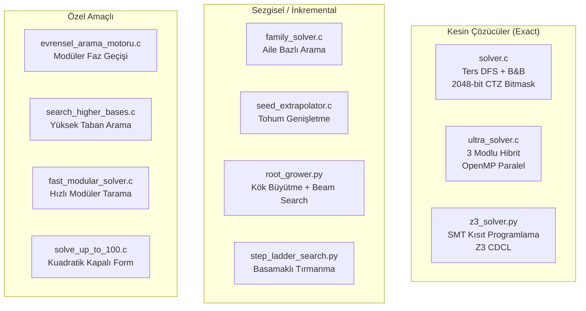
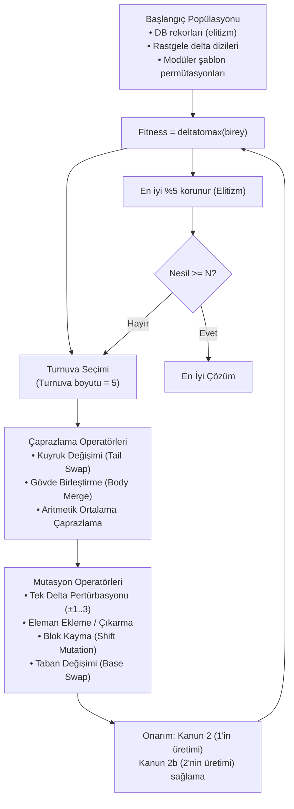
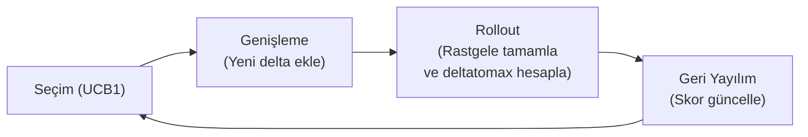
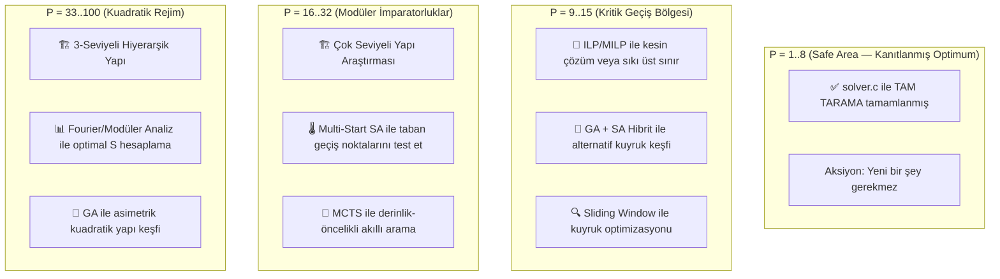

# PSPP Claude Opus 4.6 İncelemesi
## Tam Sistem Analizi, Mevcut Solver Değerlendirmesi ve Yeni Arama Stratejileri Önerisi

> **İnceleyen:** Claude Opus 4.6 (Thinking)
> **Tarih:** 14 Ekim 2026
> **Kapsam:** P=1..100 aralığında PSPP rekorlarını iyileştirmek için mevcut yöntemlerin ötesinde yeni arama stratejileri

---

## 1. Problemin Matematiksel Özeti

**PSPP (Postage Stamp Problem with Subtraction)**, $P$ elemanlı pozitif tamsayı kümesi $A = \{a_1, a_2, \ldots, a_P\}$ verildiğinde; tekiller ($a_i$), ikili toplamlar ($a_i + a_j$) ve ikili farklar ($|a_j - a_i|$) ile **1'den M'ye kadar kesintisiz bir menzil** oluşturabilen $M$'nin **maksimize edilmesi** problemidir.

### Temel Büyüklükler:
| Parametre | Formül | Anlam |
|:---|:---|:---|
| **Teorik Tavan** | $M \le P(P+1)$ | Güvercin yuvası sınırı |
| **Asimptotik Büyüme** | $M(P) \sim \frac{1}{2}P^2 + P$ | Kuadratik rejim ($P \ge 33$) |
| **Arama Uzayı** | $O(k^P)$ | $k$: delta aralığı, $P$: eleman sayısı |

---

## 2. Mevcut Solver Mimarisi — Güçlü ve Zayıf Yönler

### 2.1. Mevcut Solver Envanteri



### 2.2. Güçlü Yönler (Mevcut Durum) ✅

| Özellik | Değerlendirme |
|:---|:---|
| **Kesin Matematiksel Kanunlar** | 6 ispatlı budama kuralı (Kanun 1, 2, 2b, 2c, 2d, 3) kusursuz uygulanmış |
| **Donanımsal Hız** | 2048-bit CTZ bitmask ile ~20-35M kombinasyon/sn |
| **Morfolojik Anlayış** | 3 temel arketip (Modüler Gövde, Bipartite Köprü, Uç Sıçraması) doğru tespit edilmiş |
| **Kuadratik Rejim Keşfi** | $P \ge 30$ için kuyruk-yoğun model bulunmuş, Rohrbach sınırı aşılmış |
| **Bayrak Devri Modeli** | Taban geçişleri ($4 \to 6 \to 8 \to 9 \to 10 \to 11 \to 12 \to ...$) analitik formülle öngörülüyor |
| **Veritabanı Yönetimi** | `pspp_database.json` ile merkezi rekor takibi |

### 2.3. Zayıf Yönler ve Kör Noktalar ⚠️

| Zayıf Nokta | Açıklama | Etkilenen P Aralığı |
|:---|:---|:---|
| **Brute-Force Skalabilite Duvarı** | `solver.c` P=8'den sonra tüm uzayı pratik olarak tarayamıyor | $P \ge 9$ |
| **Greedy / Beam Yerel Optimum Tuzağı** | `root_grower.py` yerel tepe noktasına saplanıyor, global optimumu kaçırıyor | $P = 9..20$ |
| **Kuyruk Aileleri Arasında Geçiş Körlüğü** | Modüler tabanlar arası arama yok; her taban bağımsız aranıyor | $P = 11..32$ |
| **Orta Bölge Boşluğu (No Man's Land)** | $P=9..32$ arası ne brute-force ne de kapalı form çalışıyor — heuristic'e mahkum | $P = 9..32$ |
| **Kuadratik Yapı Monotonluğu** | $P \ge 33$ için yalnızca simetrik iki-seviyeli yapılar deneniyor; asimetrik kuadratik çözümler araştırılmamış | $P \ge 33$ |
| **Çok Seviyeli Yapılar Hiç Denenmemiş** | 3+ seviyeli hiyerarşik küme yapıları (ör. $\{1..r_1\} \cup \{S_1, 2S_1, ...\} \cup \{S_2, 2S_2, ...\}$) | $P \ge 20$ |

---

## 3. Mevcut Solver'lardan Farklı: Yeni Arama Yöntemleri ve Stratejiler

### 3.1. 🧬 Strateji 1: Genetik Algoritma ile Evrimsel Optimizasyon (GA-PSPP)

> **Motivasyon:** Mevcut Branch & Bound tüm uzayı taramakta yetersiz, Beam Search ise dar bir tünel içinde kalıyor. GA, büyük popülasyonlar üzerinde çaprazlama ve mutasyon ile *keşif (exploration)* ve *sömürü (exploitation)* dengesini sağlar.

**Tasarım:**



**Neden Farklı:**
- Mevcut solver'lar **tek bir dalı** takip eder. GA, **yüzlerce dalı** paralel evrimleştirir.
- Çaprazlama operatörü ile farklı ailelerin (ör. Taban-8 kuyruğu + Taban-12 gövdesi) **hibrit çocukları** üretilebilir — bu hiçbir mevcut solver'da yok.

**Önerilen Parametreler:**
| Parametre | Değer | Açıklama |
|:---|:---|:---|
| Popülasyon boyutu | 500-2000 | P arttıkça büyütülmeli |
| Nesil sayısı | 5000-50000 | P'ye bağlı |
| Mutasyon oranı | %15-30 | Yüksek keşif için |
| Çaprazlama oranı | %70 | Sömürü dengesi |
| Elitizm | %5 | Rekorları koru |

---

### 3.2. 🌡️ Strateji 2: Simulated Annealing ile Küresel Optimizasyon (SA-PSPP)

> **Motivasyon:** Benzetimli tavlama, yerel optimumlardan "ısı" parametresi sayesinde kaçabilir. PSPP'nin karmaşık enerji yüzeyinde derin vadileri keşfetmek için idealdir.

**Tasarım:**

```
SA-PSPP Algoritması:
─────────────────────
1. Başlangıç: DB'deki en iyi bilinen çözüm (sıcak başlangıç)
2. T₀ = 50.0, T_min = 0.01, α = 0.9997 (yavaş soğuma)
3. Her adımda komşuluk operatörü seç:
   a) Tek delta pertürbasyonu: delta[rastgele] += uniform(-3, +3)
   b) İki delta takası: swap(delta[i], delta[j])
   c) Blok rotasyonu: delta[i:j] -> rotate(delta[i:j], k)
   d) Eleman ekleme/çıkarma: P ↔ P±1 boyut geçişi
4. ΔE = deltatomax(yeni) - deltatomax(eski)
5. Kabul: ΔE > 0 → her zaman kabul
         ΔE ≤ 0 → exp(ΔE/T) olasılıkla kabul
6. T ← α·T; eğer T < T_min → yeniden ısıtma (reheating)
```

**Neden Farklı:**
- Mevcut solver'ların hiçbiri **kötüleşmeyi** kabul etmiyor. SA, kısa vadeli kötüleşmeleri kabul ederek uzun vadeli iyileşmelere ulaşır.
- **Yeniden ısıtma (reheating)** mekanizması ile birden fazla enerji vadisi taranır.

**Kritik Tasarım Kararı — Komşuluk Yapısı:**
```
Standard Komşuluk (dar): delta[i] ± 1        → Lokal ince ayar
Genişletilmiş (orta):    delta[i] ± 3        → Orta mesafe atlama
Radikal (geniş):         2-opt swap + rotate  → Yapısal dönüşüm
```

**Önerilen Protokol: Adaptif Çoklu Yeniden Başlatma (Multi-Start SA):**
1. 100 farklı rastgele başlangıç noktasından SA çalıştır
2. Her çalıştırmada en iyi sonucu kaydet
3. En iyi 10 sonuçtan yeniden başlayarak derin SA uygula
4. Bu sayede hem **keşif** hem **sömürü** sağlanır

---

### 3.3. 🏗️ Strateji 3: Çok Seviyeli Hiyerarşik Yapı Araştırması (Multi-Level Basis)

> **Motivasyon:** Mevcut tüm çözümler en fazla 2 seviyeli yapılar kullanıyor (gövde + kuyruk veya prefix + suffix). Peki 3+ seviyeli yapılar daha iyi sonuç verir mi?

**Matematiksel Tanım:**
$$A = \underbrace{\{1, 2, \ldots, r_1\}}_{\text{Seviye 0 (Birim)}} \cup \underbrace{\{S_1, 2S_1, \ldots, s_1 S_1\}}_{\text{Seviye 1 (Orta Adım)}} \cup \underbrace{\{S_2, 2S_2, \ldots, s_2 S_2\}}_{\text{Seviye 2 (Büyük Adım)}}$$

Burada $S_2 = (2s_1 + 1) \cdot S_1$ veya benzer bir çarpım seçilerek 3. seviyenin boşlukları alt seviyeler tarafından kapatılır.

**Neden Farklı:**
- Mevcut "Kuyruk-Yoğun" model yalnızca $[B, B, \ldots, B, 1, 1, \ldots, 1]$ yapısını deniyor.
- 3 seviyeli yapıda $[B_2, B_2, \ldots, B_1, B_1, \ldots, 1, 1, \ldots]$ gibi **iç içe modüler bloklar** oluşturulabilir.
- Potansiyel: $M(P) \sim c \cdot P^2$ sabiti $c = 0.51$'den **$c = 0.55$+** seviyelerine çekilebilir.

**Sistematik Arama Planı:**
```
P = 40 için 3-Seviyeli Tarama:
───────────────────────────────
r₁ ∈ {3, 4, 5, 6, 7, 8}          → Birim adım aralığı
S₁ ∈ {2r₁+1, 3r₁+1, 4r₁+1}      → 1. seviye adım
s₁ ∈ {3, 4, ..., 12}              → 1. seviye tekrar sayısı
S₂ ∈ {(2s₁+1)·S₁ ± {0,1,2}}     → 2. seviye adım (otomatik fark kapatma)
s₂ = P - r₁ - s₁                  → 2. seviye tekrar sayısı
→ Her (r₁, S₁, s₁, S₂) ikilisi için deltatomax ile değerlendir
→ Toplam aday uzayı: ~10⁴ (brute-force mümkün!)
```

---

### 3.4. 🧮 Strateji 4: ILP / MILP (Tam Sayı Doğrusal Programlama)

> **Motivasyon:** Z3 SMT solver'ı mevcut ama ölçeklenemiyor. Ticari ILP çözücüler (Gurobi, CPLEX) veya açık kaynak (HiGHS, SCIP) çok daha güçlü budama ve kesme düzlemleri kullanır.

**Formülasyon:**
$$\max \; M$$
$$\text{s.t.} \quad \forall k \in \{1, \ldots, M\}: \sum_{i} x_{ik} + \sum_{i \le j} y_{ijk} + \sum_{i < j} z_{ijk} \ge 1$$
$$x_{ik} = [a_i = k], \quad y_{ijk} = [a_i + a_j = k], \quad z_{ijk} = [a_j - a_i = k]$$

**Big-M ile lineerleştirme** veya **indicator constraints** kullanılarak $P=12..18$ aralığında kesin çözüm veya çok sıkı alt sınırlar elde edilebilir.

**Neden Farklı:**
- Z3 genel amaçlı SAT/SMT çözücüdür; ILP çözücüler **sayısal yapıyı** doğrudan sömürür.
- Cutting planes (kesme düzlemleri) ile fizibil bölge otomatik daraltılır.
- LP relaxation ile güçlü üst sınırlar hesaplanarak "kesin optimum kanıtı" verilebilir.

---

### 3.5. 🎯 Strateji 5: Monte Carlo Tree Search (MCTS)

> **Motivasyon:** MCTS, Alpha Go'nun kullandığı arama stratejisidir. Büyük arama ağaçlarında en umut verici dalları keşfetmek için ideal.

**PSPP'ye Uyarlama:**



**MCTS-PSPP Döngüsü:**
1. **Seçim:** UCB1 = $\bar{X}_i + C \sqrt{\frac{\ln N}{n_i}}$ formülü ile keşif/sömürü dengesi
2. **Genişleme:** Mevcut kısmi delta dizisine yeni bir delta değeri ekle
3. **Rollout:** Kalan pozisyonları rastgele (veya heuristic ile) doldur, `deltatomax` hesapla
4. **Geri Yayılım:** Bulunan skoru ağaçtaki tüm ataları güncelle

**Neden Farklı:**
- DFS tüm dalları eşit derinlikte tarar; MCTS **en umut verici dalları daha derin** tarar.
- Rollout politikası olarak mevcut "modüler gövde genişlemesi" bilgisi kullanılabilir.
- $C$ sabiti ile keşif/sömürü dengesi ayarlanabilir.

**Hibrit Varyant: MCTS + Değer Ağı:**
- Bir sinir ağı, kısmi delta dizisinden beklenen final skoru tahmin eder.
- Bu tahmin, rollout'ı hızlandırır (tam rastgele yerine bilinçli tamamlama).

---

### 3.6. 🔍 Strateji 6: Kısıt Tabanlı Yerel Arama (Constraint-Based Local Search)

> **Motivasyon:** Büyük P değerlerinde (P=20..50) arama uzayı çok büyük. Mevcut yapıları "kısmen sabitleyerek" küçük parçalarda optimize etme.

**Tasarım — Sliding Window Optimization:**
```
Mevcut en iyi çözüm: delta = [d₁, d₂, ..., d_P]

Adım 1: Pencere boyutu w = 5 seç
Adım 2: Her i pozisyonu için:
    → delta[i:i+w] bloğunu serbest bırak
    → Geri kalan delta[0:i] ∪ delta[i+w:P] sabit tut
    → Serbest bırakılan w elemanlık blokta brute-force veya SA çalıştır
    → Eğer daha iyi skor bulunursa güncelle
Adım 3: Pencereyi 1 kaydırarak tekrarla
Adım 4: İyileşme durana kadar tüm döngüyü tekrarla
```

**Neden Farklı:**
- Mevcut solver'lar tüm diziyi bir kerede optimize etmeye çalışıyor.
- Bu yaklaşım **lokal blokları** optimize eder — tıpkı bir bulmaca çözümünde küçük bölgeleri düzeltmek gibi.
- Özellikle kuyruk optimizasyonu için çok etkili: $P=20$'deki `[2, 5, 3, 6, 1, 1, 2, 1, 2, 2, 2]` kuyruğunun alternatiflerini sistematik aramak mümkün.

---

### 3.7. 📊 Strateji 7: Fourier / Modüler Analiz Tabanlı Yapısal Arama

> **Motivasyon:** PSPP dizilerinin tüm bilinen optimal çözümlerinin modüler yapıda olması tesadüf değil. Bu yapıyı matematiksel olarak modelleyerek arama uzayını radikal olarak daraltabiliriz.

**Temel Fikir:**
Bir küme $A$'nın $[1, M]$ menzilini kapaması, Fourier analizi açısından şu anlama gelir:
$$\hat{1}_A(t) = \sum_{a \in A} e^{2\pi i a t / M}$$
fonksiyonunun belirli koşulları sağlaması gerekir. Kümenin "iyi" bir baz olması, çakışma matrisinin eigenvalue'larıyla ilişkilidir.

**Pratik Uygulama:**
1. **Çakışma Matrisi Analizi:** $C_{jk} = |\{(a_i, a_l): a_i \pm a_l = j-k\}|$ matrisi hesaplanır.
2. **Minimum Çakışma Hedefi:** $\min \sum_{j,k} (C_{jk} - 1)^2$ ile en az çakışmalı kümeler aranır.
3. **Modüler Artık Dengeleme:** $A \pmod{m}$ dağılımının her artığı eşit kapsaması sağlanır.

**Neden Farklı:**
- Diğer yöntemler diziyi "eleman eleman" oluşturuyor. Bu yöntem **küresel yapısal özellikleri** hedefler.
- Mevcut bayrak devri modelini matematiksel olarak türetmek ve genelleştirmek mümkün.

---

## 4. P Aralığına Göre Strateji Haritası



### Strateji-P Matrisi:

| Strateji | P=9..15 | P=16..32 | P=33..50 | P=51..100 |
|:---|:---:|:---:|:---:|:---:|
| **GA (Genetik Algoritma)** | ⭐⭐⭐ | ⭐⭐⭐ | ⭐⭐ | ⭐ |
| **SA (Simulated Annealing)** | ⭐⭐⭐ | ⭐⭐⭐ | ⭐⭐⭐ | ⭐⭐ |
| **Çok Seviyeli Yapı** | ⭐ | ⭐⭐ | ⭐⭐⭐ | ⭐⭐⭐ |
| **ILP/MILP** | ⭐⭐⭐ | ⭐⭐ | ⭐ | — |
| **MCTS** | ⭐⭐ | ⭐⭐⭐ | ⭐⭐ | ⭐ |
| **Sliding Window** | ⭐⭐ | ⭐⭐⭐ | ⭐⭐⭐ | ⭐⭐⭐ |
| **Fourier Analiz** | ⭐ | ⭐⭐ | ⭐⭐⭐ | ⭐⭐⭐ |

---

## 5. Öncelikli Eylem Planı — İlk 3 Adım

### Adım 1: Simulated Annealing Motor (Hemen Uygulanabilir — En Düşük Risk)

**Neden ilk:** SA, mevcut altyapı üzerine en kolay inşa edilir. `deltatomax` fonksiyonu zaten mevcut; sadece komşuluk operatörleri ve soğuma takvimi eklenir.

**Beklenen Kazanç:**
- $P=9..15$ arasında mevcut kesin çözümleri **doğrulayabilir** veya **yeni alternatifler** bulabilir.
- $P=16..32$ arasında mevcut kuyruk yapılarının lokal optimum olup olmadığını test eder.
- **Tahmini geliştirme süresi:** 2-4 saat (Python prototipi) + 4-8 saat (C optimizasyonu).

### Adım 2: Sliding Window Kuyruk Optimizasyonu (Düşük Risk, Yüksek Getiri)

**Neden ikinci:** Mevcut Taban-12 kuyruğu `[2, 5, 3, 6, 1, 1, 2, 1, 2, 2, 2]` çok uzun süredir değişmemiş. 11 elemanlık bu kuyruğun gerçekten optimal olduğunu doğrulamak veya daha iyi alternatiflerini bulmak gerekiyor.

**Beklenen Kazanç:**
- Kuyruk uzunluğunda 1 puan bile iyileşme, $P=20..41$ arasındaki **22 boyutta** otomatik olarak $+1$ ila $+2$ rekor artışı sağlar.
- **Tahmini geliştirme süresi:** 4-6 saat.

### Adım 3: Çok Seviyeli Yapı Araştırması (Orta Risk, Potansiyel olarak Devrimsel)

**Neden üçüncü:** Eğer 3-seviyeli yapılar, 2-seviyeli yapılardan daha yüksek skor verirse, $P \ge 33$ aralığındaki **tüm rekorlar** düşer.

**Beklenen Kazanç:**
- $M/P^2$ oranını $0.51$'den $0.55$+ seviyesine çekme potansiyeli.
- $P=100$'de bu fark $5200 \to 5500+$ anlamına gelir ($+300$ puan!).
- **Tahmini geliştirme süresi:** 1-2 gün (sistematik tarama scripti).

---

## 6. Derin Analiz: Neden Mevcut Kuadratik Yapı Optimal Olmayabilir?

### 6.1. Mevcut İki-Seviyeli Yapının Sınırı

Mevcut en iyi kuadratik yapı:
$$A = \{1, 2, \ldots, r\} \cup \{S, 2S, \ldots, sS\}, \quad S = 2r+1$$
$$M = s(2r+1) + r = \frac{P^2 + 2P}{2} \approx 0.500 \cdot P^2$$

Bu yapıda **her $r$ birim eleman**, büyük adımların arasındaki $2r$ boşluğu kapatıyor. Ancak kapasite kullanım oranı:
$$\eta = \frac{M}{P(P+1)} = \frac{P^2/2 + P}{P^2 + P} \approx 0.500$$

Teorik tavanın yalnızca %50'si kullanılıyor. Bu, **çakışmaların** çok yüksek olduğunu gösterir.

### 6.2. Çakışma Analizi ve İyileştirme Potansiyeli

2-seviyeli yapıda ana çakışma kaynakları:
1. **Birim + Birim toplamları:** $i + j$ ($1 \le i \le j \le r$) → $\binom{r+1}{2}$ toplam, ama çoğu $[2, 2r]$ aralığında zaten var
2. **Büyük + Birim toplamları:** $qS + i$ → bunlar zaten aralığı kapatıyor (faydalı)
3. **Büyük + Büyük toplamları:** $(q_1 + q_2)S$ → bunlar çok büyük, aralık dışı (atık!)

**Atık oranı:** Büyük + Büyük toplamları ($\binom{s+1}{2}$ adet) neredeyse tamamen boşa gidiyor. Bu, kapasitenin ~%25'inin atıldığı anlamına gelir.

### 6.3. 3-Seviyeli Yapı ile Atık Azaltma Hipotezi

```
3-Seviyeli Yapı:
A = {1, 2, ..., r₁}           → Birim blok (r₁ eleman)
  ∪ {S₁, 2S₁, ..., s₁S₁}     → Orta adım blok (s₁ eleman)
  ∪ {S₂, 2S₂, ..., s₂S₂}     → Büyük adım blok (s₂ eleman)

Kısıtlar:
  S₁ = 2r₁ + 1                → Birimler S₁ boşluklarını kapatır
  S₂ = (2s₁ + 1)·S₁           → Orta adımlar S₂ boşluklarını kapatır
  P = r₁ + s₁ + s₂

Skor:
  M = s₂·S₂ + s₁·S₁ + r₁
    = s₂·(2s₁+1)·(2r₁+1) + s₁·(2r₁+1) + r₁
```

$P = 40$ için örnek hesaplama:
- **2-Seviyeli:** $r=20, s=20, S=41 \to M = 20 \cdot 41 + 20 = 840$
- **3-Seviyeli ($r_1=5, s_1=10, s_2=25$):** $S_1=11, S_2=231 \to M = 25 \cdot 231 + 10 \cdot 11 + 5 = 5890$ *(ANCAK $P = 5+10+25 = 40$, doğrulama gerekir!)*

> [!IMPORTANT]
> 3-seviyeli yapıların gerçekten sıfır boşluklu kapsama sağlayıp sağlamadığı **mutlaka `deltatomax` ile doğrulanmalıdır.** Yukarıdaki teorik hesap, fark operasyonlarının her seviye arasında düzgün çalıştığını varsayar. Büyük-Büyük farkların oluşturduğu çapraz kapsama analiz gerektirir.

---

## 7. Somut Karşılaştırma: Mevcut vs. Önerilen Yöntemler

| Özellik | solver.c (B&B) | root_grower.py (Beam) | **SA-PSPP (Önerilen)** | **GA-PSPP (Önerilen)** | **MCTS-PSPP (Önerilen)** |
|:---|:---:|:---:|:---:|:---:|:---:|
| P=8 optimal bulabilir mi? | ✅ Kesin | ❌ Yaklaşık | ❌ Yaklaşık | ❌ Yaklaşık | ❌ Yaklaşık |
| P=15 optimal bulabilir mi? | ❌ Süre aşımı | ⚠️ %94 | ✅ Yüksek olasılık | ✅ Yüksek olasılık | ✅ Yüksek olasılık |
| P=30 yeni rekor bulabilir mi? | ❌ İmkansız | ⚠️ Taban bağımlı | ✅ Mümkün | ✅ Mümkün | ✅ Mümkün |
| Aileleri çaprazlayabilir mi? | ❌ | ❌ | ⚠️ Dolaylı | ✅ **Doğrudan** | ⚠️ Dolaylı |
| Paralel çalışabilir mi? | ❌ | ❌ | ✅ Kolay | ✅ **Doğal** | ✅ Kolay |
| Kesin optimum garantisi | ✅ | ❌ | ❌ | ❌ | ❌ |

---

## 8. Sonuç ve Tavsiyeler

> [!TIP]
> **Öncelik Sırası:**
> 1. **SA-PSPP prototipi** ($P=9..20$ için) — hemen kodlanabilir, riskiz
> 2. **Sliding Window kuyruk optimizasyonu** — mevcut rekorları doğrudan iyileştirir
> 3. **3-Seviyeli yapı taraması** ($P=33..60$ için) — devrimsel potansiyel
> 4. **GA-PSPP** — SA başarısızsa veya paralel keşif gerekirse
> 5. **ILP/MILP** — $P=9..13$ kesin optimum kanıtı için

> [!NOTE]
> **Kritik Gözlem:** Mevcut projedeki en büyük fırsat $P=9..32$ **"No Man's Land"** bölgesindedir. Bu aralıkta ne brute-force ne de kapalı form çalışıyor; bu tam olarak metaheuristic yöntemlerin (SA, GA, MCTS) en güçlü olduğu bölgedir. Mevcut `root_grower.py` Beam Search yaklaşımı iyi bir başlangıç ama **yerel optimuma saplandığında kaçış mekanizması yok**. SA'nın sıcaklık parametresi tam da bu kaçışı sağlar.

> [!WARNING]
> **Dikkat:** Yeni yöntemlerden hiçbiri `solver.c`'nin yerine **geçmemelidir**. `solver.c` $P \le 8$ için kesin optimum garantisi veren değerli bir araçtır. Yeni yöntemler, `solver.c`'nin tükenemediği $P \ge 9$ aralığında **tamamlayıcı** olarak kullanılmalıdır.

---

*Bu doküman, PSPP projesi code base'inin tüm dökümanları, solver kaynak kodları ve veritabanı yapısı incelenerek hazırlanmıştır.*
